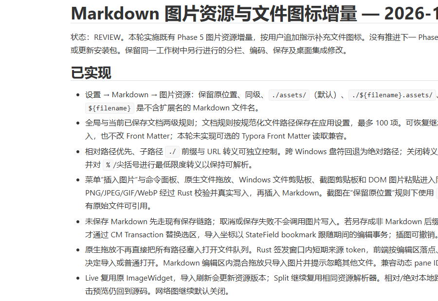

# Markdown 图片资源与文件图标增量 — 2026-10-15

状态：REVIEW。本轮实施既有 Phase 5 图片资源增量，按用户追加指示补充文件图标。没有推进下一 Phase，没有提交、推送、发布或更新安装包。保留同一工作树中另行进行的分栏、编码、保存及桌面集成修改。

## 已实现

- 设置 → Markdown → 图片资源：保留原位置、同级、`./assets/`（默认）、`./${filename}.assets/`、自定义相对目录。`${filename}` 是不含扩展名的 Markdown 文件名。
- 全局与当前已保存文档两级规则；文档规则按规范化文件路径保存在应用设置，最多 100 项。可恢复继承全局规则。无 YAML 写入，也不改 Front Matter；本轮未实现可选的 Typora Front Matter 读取兼容。
- 相对路径优先、子路径 `./` 前缀与 URL 转义可独立控制。跨 Windows 盘符回退为绝对路径；关闭转义时使用尖括号目的地址，并对 `%`/尖括号进行最低限度转义以保持可解析。
- 菜单“插入图片”与命令面板、原生文件拖放、Windows 文件剪贴板、截图剪贴板和 DOM 图片粘贴进入同一 `ImageImporter`。PNG/JPEG/GIF/WebP 经过 Rust 校验并真实写入，再插入 Markdown。截图在“保留原位置”规则下使用 `./assets/`，因为截图没有原始文件可引用。
- 未保存 Markdown 先走现有保存链路；取消或保存失败不会调用图片写入。若另存成非 Markdown 后缀，拒绝导入。复制成功后才通过 CM Transaction 替换选区，导入坐标以 StateField bookmark 跟随期间的编辑事务；插图可撤销。
- 原生拖放不再直接把所有路径塞入打开文件队列。Rust 签发窗口内短期来源 token，前端按编辑区落点、窗格及 Markdown 类型决定导入或普通打开。Markdown 编辑区内混合拖放只导入图片并提示忽略其他文件。兼容动态 pane ID。
- Live 复用原 ImageWidget，导入刷新会更新资源版本；Split 继续复用相同资源解析器。相对/绝对本地路径均经过 Rust 授权。点击预览仍回到源码。网络图继续默认关闭。
- 52 种 16px 本地 SVG 文件图标，9 组深浅主题配色，统一用于文件树、标签页、搜索结果与快速打开。覆盖编辑器支持的语言及常见资源，README、LICENSE、环境变量、依赖清单和锁文件单独识别，未知后缀有统一回退。图标映射不改变语法识别或文件读写。

参考：[Typora 官方图片设置](https://support.typora.io/Images/)。借鉴目录与路径选项，文档级设置采用应用侧存储。

## 文件权限与取舍

写入命令需要已存在的真实 `.md/.markdown` 文档 token，并验证窗口所有者；图片来源只允许原生选择器、真实系统剪贴板、原生 Drop 签发的 token，或受大小/类型限制的图片字节。没有任意本地路径读写命令。

Markdown 所在目录及其附件子目录可用于单文件模式，无需工作区。`..` 在后端先做词法归一化；解析到文档目录外的自定义目录必须通过原生文件夹选择器明确选择**完全相同**的目标目录授权，该外部目录需预先存在。绝对目录设置、设备名、ADS、控制字符和无效路径被拒绝；符号链接/目录联接不获得写权限。

Windows 在验证后持有祖先目录句柄，拒绝写入期间的目录替换，读取叶子采用禁止跟随重解析点的句柄，目标经临时文件 fsync 后以不覆盖方式创建。Unix 使用 `openat`/`mkdirat`/`O_NOFOLLOW`/`O_EXCL` 与目录 FD，不重新跟随文本路径。新增的 Unix 直接依赖 `rustix` 已在 Cargo.lock 中作为传递依赖存在；无前端依赖或网络图片上传。

同名文件与链接都视为冲突，依次产生 `name-1.png` 等名称。只接收 PNG/JPEG/GIF/WebP；扩展名需匹配实际图片头。单张 4 MiB、16 MP、单边 16384；继续保留预览总 32 MiB/32 MP 的限制。格式检查验证签名与有界尺寸头，不承诺完整解码所有损坏图片，最终解码失败保留源码提示。

“保留原位置”的文档外图片只取得本会话的精确读授权；重新打开后可在 Widget 中点击“授权此本地图片…”重新选择同一文件，或加入工作区。授权不会扩展成整盘读取。

## 本轮变更文件与用途

| 路径 | 本轮用途 |
|---|---|
| `src-tauri/src/files/images.rs` | 受限来源/目录/预览授权、真实图片复制、句柄保护、大小与格式限制 |
| `src-tauri/src/files/images_tests.rs` | 单文件落盘、同名、移动重开、外部精确授权、ACL 与目录联接测试 |
| `src-tauri/src/files/mod.rs` | 图片能力存储与窗口/文档关闭时授权回收 |
| `src-tauri/src/files/tests.rs` | 将旧的单文件禁止预览预期更新为允许文档附件子目录 |
| `src-tauri/src/commands/files.rs` | 图片选择、导入、剪贴板文件来源、目录/预览授权与来源回收命令 |
| `src-tauri/src/commands/settings.rs` | 图片规则 JSON 持久化、旧设置默认与边界验证 |
| `src-tauri/src/lib.rs` | 原生 Drop 分流与图片命令注册 |
| `src-tauri/Cargo.toml`、`src-tauri/Cargo.lock` | Windows 剪贴板 API feature、Unix rustix 直接依赖声明 |
| `src-tauri/capabilities/default.json`、`src-tauri/gen/schemas/capabilities.json` | 现有剪贴板插件的读取图片权限及生成能力索引 |
| `src/editor/markdown/imageImport.ts` | 统一导入服务、bookmark、路径/规则生成、截图 RGBA→PNG |
| `src/editor/markdown/images.ts` | 共用路径解析、外部精确预览授权，保留受控网络和内存预算 |
| `src/editor/markdown/imageField.ts` | 资源刷新版本，更新同路径 Widget 缓存 |
| `src/editor/core/DocumentManager.ts` | 本轮仅接入图片 bookmark 扩展；其余大范围布局变更来自并行工作 |
| `src/features/shell/editorSettings.ts` | 全局与每文档图片规则的默认、迁移和校验 |
| `src/components/modals/ImageSettings.vue` | 图片位置与路径设置区域 |
| `src/components/modals/SettingsModal.vue`、`src/App.vue` | 设置数据与当前文档规则绑定 |
| `src/app/useAppShell.ts` | 导入入口、保存前置、原生落点分流、快捷粘贴与文件图标元数据 |
| `src/features/shell/fileIcons.ts` | 52 个向量字形及文件名/扩展名映射 |
| `src/components/common/FileIcon.vue` | 共用 SVG 组件、主题及强制对比度模式 |
| `src/components/layout/TabBar.vue` | 用文件类型图标替换后缀文字标记；保留并行修改的标签行为 |
| `src/components/layout/TreeNodeItem.vue` | 目录树文件图标，目录图标保留 |
| `src/components/layout/Sidebar.vue` | 搜索结果图标 |
| `src/components/modals/CommandPalette.vue`、`src/types/index.ts` | 快速打开文件图标与可选 fileName 元数据 |
| `src/styles/main.css` | 删除已不使用的旧后缀色块样式 |
| `tests/markdown-images.test.ts` | 规则/路径、异步事务、失败无修改、取消保存及授权取消测试 |
| `tests/markdown-stage-a.test.ts` | 绝对本地路径仍受后端授权、资源版本缓存的预期更新 |
| `tests/markdown-images-native.mjs`、`tests/image-clipboard-helper.ps1` | 待恢复验收的独立应用标识原生 fixture；剪贴板辅助进程保留并恢复原内容 |
| `docs/Markdown图片资源与文件图标.md`、`docs/阶段进度与验收台账.md` | 本报告与进度记录 |

## 真实验证记录

| 命令/检查 | 结果 |
|---|---|
| `pnpm test` | PASS，当前工作树 24 套件、245/245（包含其他并行专项测试） |
| `pnpm exec vitest run --pool=forks --maxWorkers=1 --minWorkers=1 tests/markdown-images.test.ts tests/markdown-stage-a.test.ts` | PASS，28/28；其中新图片服务测试 10 项 |
| `cargo check --manifest-path src-tauri/Cargo.toml --locked --offline` | PASS |
| `cargo test --manifest-path src-tauri/Cargo.toml --locked --offline --lib` | PASS，当前工作树 83/83，包含真实 Windows 文件系统/ACL/目录联接；在正常 Windows 权限下执行 |
| `pnpm typecheck` | FAIL，当前并行新增 `tests/batch-syntax-and-encoding.test.ts:94` 的 `text`、`version` 两个未使用参数（TS6133）；未改动另一专项测试 |
| `pnpm build` | FAIL，同上，停在 vue-tsc；本轮较早快照曾通过，不作为最终组合代码通过证据 |
| `pnpm exec vue-tsc --noEmit -p test-results/file-icons/tsconfig.json` | PASS，检查所有生产 src 的 TS/Vue，排除正在并行修改的 tests |
| 图标无头浏览器检查 | PASS，52 字形覆盖、16px 对齐、大小写/Windows 路径/特殊文件映射、深浅主题、TabBar/TreeNodeItem/CommandPalette 三组件；errors 空 |
| `node --check tests/markdown-images-native.mjs` | PASS，脚本语法检查 |
| 独立 lint | NOT RUN，仓库未配置 lint 命令 |
| Windows Tauri 图片交互 | 未通过验收：第一次与已安装程序的单实例标识相撞；改用独立测试标识后，在进行中的布局重构中遇到 `manager.subscribe is not a function` 白屏。用户随后明确要求“另一处仍在进行，暂缓原生验收”，已停止，不因其后代码恢复而自行重跑 |
| macOS/Linux、真实系统 IME、Explorer 实际拖放、原生选择器、截图/文件系统剪贴板端到端 | NOT RUN，等待用户恢复原生验收/对应平台 |

证据：`test-results/file-icons/results.json`、`dark.png`、`light.png`、`quick-open.png`。原生失败记录：`test-results/markdown-images-native/1792034251790/` 与 `1792034346531/`；无图片原生通过记录。沙箱内曾因 rename/ACL/目录联接限制造成旧 Rust 测试失败，正常权限重跑全部通过；未修改用户目录权限。

## 待人工验收与限制

1. 打开独立 Markdown，设置五种位置，分别使用菜单/命令、Explorer 拖放、截图粘贴、文件粘贴，核对磁盘文件与引用一致。Source 中插入的同一引用切回 Live/Split 应可预览，图片点击返回正确源码。编辑区内图片不得成为普通文件标签。
2. 新建 Untitled Markdown，导入时取消保存，确认没有附件；再保存为 Markdown 后导入。只读目录/错误后缀/超限文件失败时不插入引用。测试导入期间编辑、切标签、IME、撤销/重做和关闭保护。
3. 使用中文/空格/括号/百分号图片名、同名、多根工作区、`${filename}`、相对/跨盘绝对路径；移动 Markdown 与附件树后重开。自定义文档外目录必须匹配明确授权，取消授权不写入。
4. 观察文件树、标签、搜索结果与 Ctrl+P 的同一文件图标，切换深浅主题与 125%/150% DPI。图标组件浏览器检查已通过，原生 DPI 尚未验证。

已知边界：只导入四种栅格类型，SVG 仅显示文件类型图标、不获得 Markdown 图像写入/预览权限；UNC/协议相对图片路径继续保守阻止自动预览（避免意外网络共享访问）。文档规则按路径保存，另存/移动后不自动迁移规则；附件不会因重命名/移动自动搬迁，用户同时移动附件树或编辑引用后可重开。撤销插图只撤销源码，不自动删除磁盘资源，以免删除仍被其他文档引用的文件。写入后若文档已改位置或开始 IME，保留文件并提示真实路径，避免插入失效引用。

完成门槛尚未达到：生产源码检查、单元与图标浏览器检查通过；整仓 typecheck/build 被并行测试类型错误阻断，Windows 图片端到端及跨平台未验收。保留 REVIEW，不宣称 DONE。
