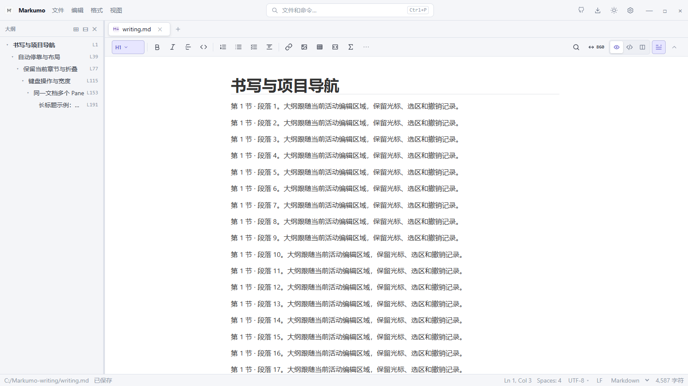
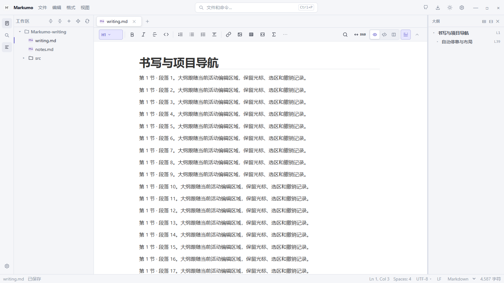
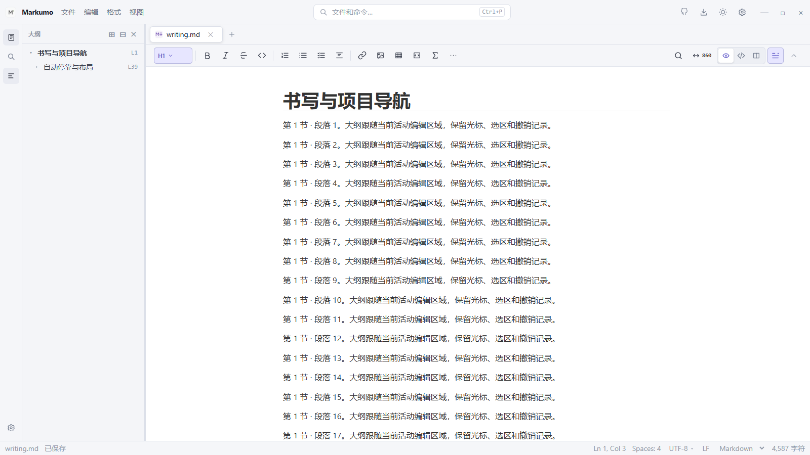
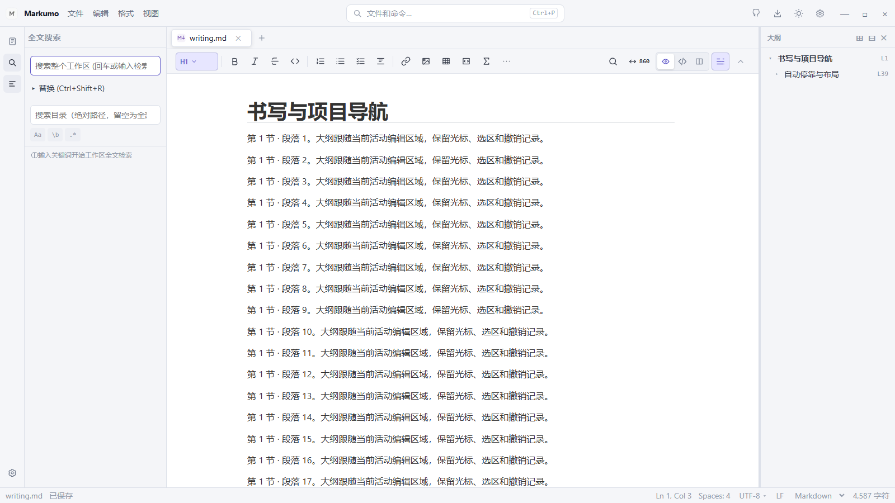
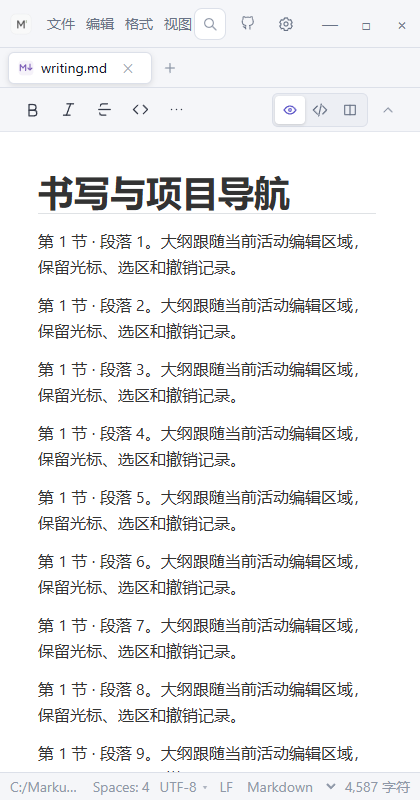
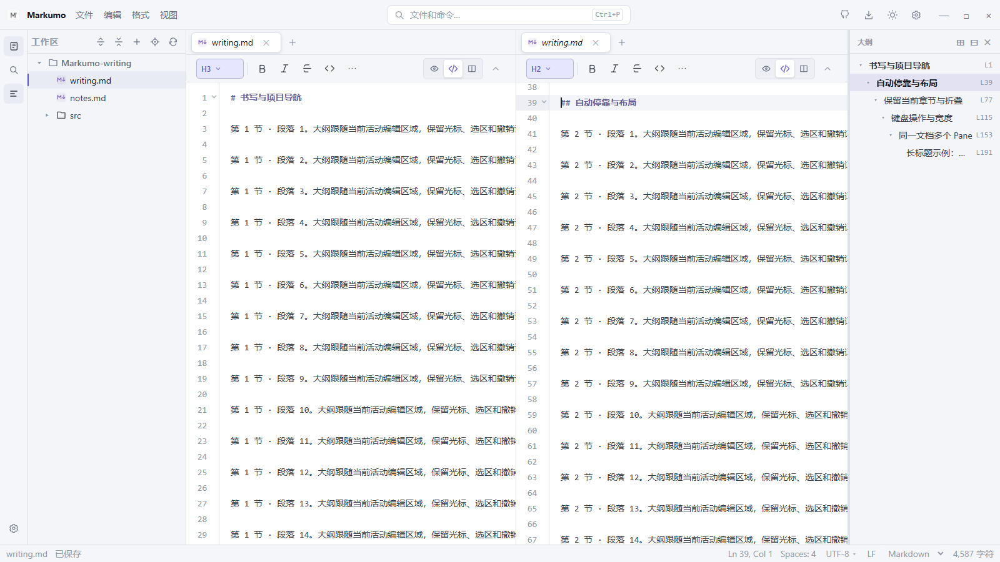
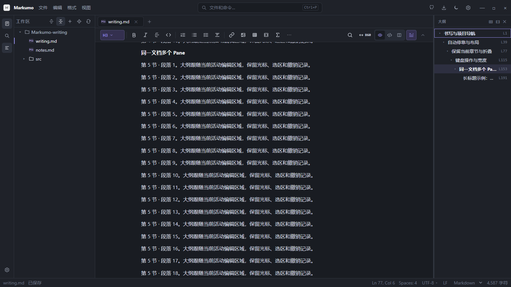

# 大纲自动停靠验收

2026-10-22。全部改动在 main，未推送，未修改版本号。

## 状态与唯一实例

此前活动栏通过 `sidebarPanel='outline'` 在 Sidebar 中创建大纲，同时 EditorContainer 还可根据 `showOutline` 创建第二份。现在 Sidebar 只承载工作区内容，EditorContainer 唯一拥有 OutlineView。

- 持久化偏好仍只有既有的 `showOutline`、`outlineWidth`。
- `outlineVisible = showOutline && !focusMode`；专注模式只遮蔽显示，不写入隐藏偏好。
- `leftSidebarOccupied` 仅在工作区模式、侧边栏展开、面板为 files/search 且不在专注模式时为真。App 实际挂载 Sidebar 的条件与它一致。
- `effectiveOutlinePosition = leftSidebarOccupied ? 'right' : 'left'`，纯 computed，不保存位置，也不反向修改侧边栏状态。
- 活动栏、Markdown 工具栏、视图菜单、关闭按钮共用 showOutline；旧的 `handleSelectPanel('outline')` 也只切换这一偏好。
- 左右迁移通过 CSS order 调整同一个 aside/OutlineView 的视觉顺序。隐藏、窄窗口和专注模式使用 v-show，不重复挂载，不重建编辑器。

## 导航与宽度

沿用 outlineService 的 Markdown / 代码符号结果及 DocumentManager 跳转；不改解析器、Markdown 渲染、代码块或公式。

支持 H1–H6、章节高亮、低饱和主题背景、全部展开/收起、上下/Home/End 导航和左右展开/收起。光标移动优先标记所在章节，阅读滚动后跟随视口；短暂的编辑器自动滚动不抢走刚更新的光标章节。切换 Pane、文档、模式时重新绑定当前位置。

Live 标题定位修正了 H4–H6 行框留白造成的命中偏差：仅缓存当前不可变文档的前 1000 个标题位置，滚动时二分测量其实际边界，不产生编辑事务。

宽度默认 240px，首选范围 160–520px。左停靠拖右边界，右停靠拖左边界；拖动只更新临时宽度，松开后通过既有设置机制保存。方向键、Home/End 和双击恢复默认也可用；取消、失焦及布局迁移会清理捕获和全局监听。

ResizeObserver 读取编辑容器实际可用宽度。普通 Pane 预留 280px，Markdown Split 预留 420px；横向多 Pane 按拆分比例推算所需宽度，纵向取最大值。可用宽度不足时临时收起大纲，恢复宽度时自动显示，使用 32px 滞回避免临界抖动。临时限制不回写 showOutline 或用户保存宽度。极窄时采用收起策略，扩大编辑容器即可恢复。

## 实际修改文件

| 文件 | 改动 |
| --- | --- |
| `src/App.vue`、`src/app/useAppShell.ts` | 唯一可见状态、纯派生位置、实际侧边栏占位与专注恢复 |
| `src/app/useShellCommands.ts`、`ActivityBar.vue` | 统一开关和搜索命令入口 |
| `src/components/layout/Sidebar.vue` | 移除重复大纲挂载与订阅 |
| `src/components/layout/EditorContainer.vue` | 同实例左右停靠、实际容器预算、拖动/保存、统一标题栏 |
| `src/components/layout/OutlineView.vue` | 保留折叠状态、批量展开/收起、键盘树导航、主题选中背景与省略 |
| `src/editor/outline/useOutlineViewport.ts` | 光标/滚动联动与 Pane、模式切换 |
| `src/editor/markdown/wysiwyg/MarkdownEditorController.ts` | 仅大纲视口读取方法的标题边界与缓存 |
| `scripts/outline-docking-regression.mjs` | 真实 App 的 8 组完整操作链 |
| `scripts/outline-navigation-regression.mjs`、`markdown-live-toolbar-regression.mjs`、`run-regressions.mjs` | 调整左边界方向和保留实例断言，注册 Smoke / 全量门禁 |
| 本文与 `docs/images/outline-docking/` | 实际截图和验收记录 |

工作区原有并行任务的代码结构、PDF、专注模式等修改保留。本轮提交按自身范围整理，并额外导出提交文件进行独立类型检查和浏览器验证；该导出是 ignored 验证产物，没有建立分支或 Git 工作树。

## 浏览器验收

使用 Google Chrome 真实渲染 App；原生 IPC 与设置保存使用测试替身，设置重启链通过浏览器重新加载验证。没有声称在此浏览器测试中执行了真实操作系统磁盘写入。截图均已打开目视核对；浅/深主题截图等待过渡结束，避免中间帧误判颜色。

8 组覆盖：单文件；文件树/搜索开启关闭；所有开关入口；两侧拖动与重启/临时宽度；Live/Source/Split、光标与滚动；全量展开/收起和键盘导航；多 Pane、非均匀拆分与当前 Pane 跳转；专注恢复、文档和代码符号切换。比较了同一大纲与编辑器实例、原文、选区、dirty 和 Undo/Redo 深度。

旧工具栏测试原先要求隐藏时 DOM 被卸载，已改为检查不可见且同一实例保留。未删除交互或选区断言。既有大纲导航 13 组通过；代码符号兼容 21 组通过，专注模式显示检查也验证偏好不被改写。

| 最终执行项 | 结果 |
| --- | --- |
| `pnpm typecheck` | 通过，退出码 0 |
| `pnpm build` | 通过，退出码 0；保留既有模块 externalization / 大 chunk 提示 |
| `pnpm test:smoke` | 30 / 30 通过，0 失败，0 跳过，253.43 秒 |
| `pnpm test:regression` | 41 / 41 通过，0 失败，0 跳过，460.32 秒 |
| 独立提交内容导出验证 | 类型检查、生产构建、8 组真实浏览器操作链通过 |

门禁计数包含当前工作区已有的并行专项；本轮提交只收录自动停靠相关改动。首次 Smoke 的旧卸载断言失败已按保留实例的新行为修正，最终完整复跑通过。

详细日志位于 `test-results/outline-docking/`。测试使用 `MARKUMO_CHROME` 指定系统 Chrome，TEMP/TMP 指向本工作区测试目录。最终 Smoke 使用仓库已有的 `MARKUMO_DESKTOP_NO_RELOAD=1`，避免测试产物触发 Vite 文件监听；没有跳过测试或关闭编辑器运行时更新。

## 真实 UI 截图

## 已知边界

- 原生 Tauri WebView 的字体回退、不同 DPI 及系统级拖动体验仍适合人工复核；本轮自动验收使用真实 Chrome。
- 大纲解析与数量预算沿用既有服务；未知语言不新增语义解析能力。
- 宽度预算优先释放大纲占位，不改写用户已有的 Pane 比例；超出屏幕物理容量的多 Pane 继续遵循既有布局限制。
- 左右停靠使用 CSS 视觉顺序，Tab 仍沿原有 DOM 顺序移动；进入大纲后可使用方向键、Home/End 和 Enter。
