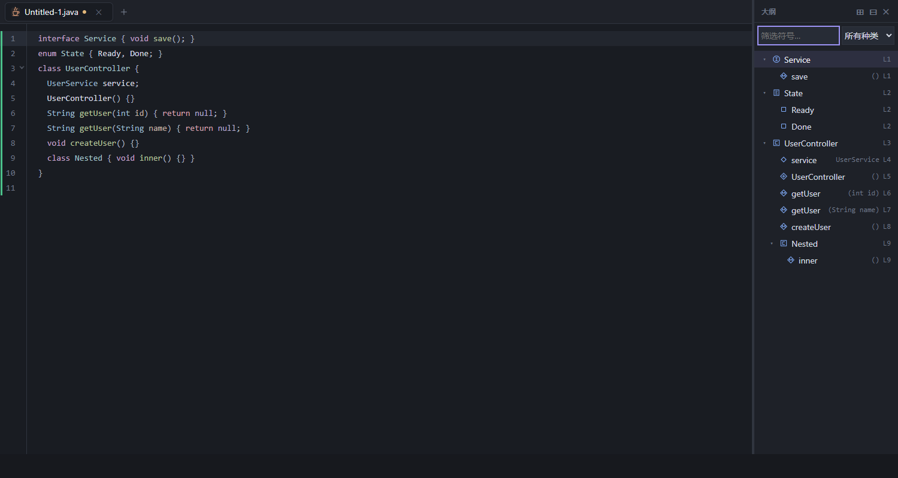

# 代码结构导航验收

## 基线与范围

2026-10-22 检查了 `outlineService.ts`、左右大纲组件、DocumentManager、语言注册表、编辑器扩展及现有大纲回归。用户指定的 `https://github.com/pucj0/Markumo` 的 main 是 `f9e1f66`，与当前 origin 的起始 main 相同；保留本地后续的大纲/Markdown 提交和先前未提交的 Phase 05/06 补丁。本次只在 main 工作，提交仅包含代码结构升级，不推送、不改版本、不引入依赖、LSP 或工作区索引。

原代码用一组跨语言节点名和名称节点候选平铺提取；当前改为语言适配器，仍保留 `extractOutline()`、Markdown 标题解析和现有定位接口。

等待并保留自动停靠布局提交 `f288f6d8e9ed364ce814d05304743268dfa22f81` 后完成适配：由 EditorContainer 中同一个 OutlineView 展示结构，随工作区侧栏左右迁移。Sidebar 不再重复挂载大纲；本次没有恢复旧的双大纲，也没有重新实现布局、打字机或 PDF 查看器。

## 实测语言矩阵

基于 `scripts/fixtures/code-structure.json`，使用**项目实际注册的扩展**构造 EditorState，完成并提交 CodeMirror 语法树快照后检查节点。旧实现通过 Git 中的基线源码单独加载比较，避免凭语法名猜覆盖率。数量只代表该 fixture，不代表整个语言的覆盖率；旧结果全部是 level 1。

| 语言 | 已核实的主要节点 | 本次符号支持 | 基础 fixture 旧 → 新 |
| --- | --- | --- | --- |
| Java | ClassDeclaration/Definition、MethodDeclaration/Definition、ConstructorDeclaration、VariableDeclarator、EnumConstant | 类、接口、枚举、构造器、方法、字段、枚举项；另测 RecordDeclaration/RecordComponent | 2 → 13 |
| JavaScript | FunctionDeclaration/VariableDefinition、MethodDeclaration/PropertyDefinition、ArrowFunction、PropertyDeclaration、Property、ObjectExpression | 函数、已绑定箭头/函数表达式、类、构造器、方法、字段、对象及对象方法 | 6 → 11 |
| TypeScript | InterfaceDeclaration/TypeDefinition、MethodType、PropertyType、TypeAliasDeclaration、EnumDeclaration/EnumBody | JS 能力，接口成员、类型别名、枚举项、重载签名 | 7 → 16 |
| JSX | JS 声明节点与 JSXElement | 函数组件、已绑定箭头组件及真实嵌套声明；不把标签当符号 | 2 → 3 |
| TSX | TS 声明节点与 JSXElement | 接口、类型与 JSX 能力 | 1 → 4 |
| Vue | Document → Element → Script 中的 JS/TS 挂载树 | script/script setup 的声明与成员；排除 template、style 文本 | 4 → 7 |
| Python | ClassDefinition/VariableName、FunctionDefinition、Body、DecoratedStatement | 类、方法、`__init__`、函数、内部函数、类体命名赋值字段、装饰器方法、async 函数 | 5 → 6 |
| Go | TypeSpec/DefName、StructType/FieldDecl、InterfaceType/MethodElem、FunctionDecl、MethodDecl | struct、interface、类型声明/别名、字段、接口方法、函数、接收者方法 | 0 → 8 |
| Rust | StructItem/TypeIdentifier、FieldDeclaration/FieldIdentifier、EnumItem/EnumVariant、TraitItem、ImplItem、FunctionItem/BoundIdentifier、TypeItem | struct、字段、enum/变体、trait、impl 组、方法、函数、内部函数、类型别名 | 0 → 15 |
| C++ | NamespaceDefinition、ClassSpecifier/StructSpecifier/FieldDeclarationList、FunctionDeclarator、PointerDeclarator、EnumSpecifier/Enumerator、AliasDeclaration | namespace、具名类/struct 定义、字段、构造器、方法、函数及原型、枚举项、using 别名；另测指针返回包装 | 0 → 13 |
| PHP | ClassDeclaration/Name、InterfaceDeclaration、TraitDeclaration、MethodDeclaration、FunctionDefinition、VariableDeclarator | 类、接口、trait、`__construct`、方法、字段、函数、嵌套函数；另测 EnumDeclaration/EnumCase | 8 → 10 |

Java 旧 fixture 的两个结果实际错误地使用了方法的返回类型名 `String`，本次改为声明名称 `getUser`，并用参数区分重载。

### 能力边界

- Plain Text 不提取结构。C、C#、Kotlin、Swift、Ruby、Dart、Shell、PowerShell 等 `parser: stream` 注册项明确显示“仅提供词法高亮”，不冒充结构树。
- HTML、CSS、JSON、XML、YAML、SQL 等其他 Lezer 注册项当前无声明适配器，会显示尚未提供结构适配。Vue 仅处理 Script 子树。
- 只显示能从指定语法节点确定的命名声明；不扫描全文正则，不猜动态赋值、反射、宏展开结果或隐式生成成员，不做类型解析。
- C++ 类/struct/enum 要求定义体，避免将 `class T*`、`enum T` 类型使用当成重复定义；不合并前置声明、类外定义或模板实例，不承诺所有复杂 typedef/声明器形式。
- Python 字段限于类体命名赋值，不从方法内 `self.x` 推断字段。Go 不合成匿名嵌入字段，Rust 不给无名元组字段制造名称。

## 层级与导航

`codeAdapters.ts` 是小型语言注册表：JS/TS/JSX/TSX/Vue 共用经过核实的同族语法形状，其余语言分别处理。名称必须来自声明的实际子节点；参数详情来自对应 ParamList/FormalParameters/Parameters/ParameterList 节点，最多显示 140 个代码单元。

遍历复用当前 Lezer 树，用半开语法范围栈生成 `parentId` 和 `level`。方法、字段处于真实所属类型下，内部函数处于外层函数下。Rust impl 按自己的实际声明范围成组。Go 接收者方法和 C++ 类外方法保留原词法位置/接收者信息，不用文本名称推断跨范围归属。声明与实现是不同语法声明，不通过不可靠的同名合并抹去它们。

稳定 ID 基于父级路径、种类、名称、参数和重复序号，不使用绝对行偏移。正文修改或前方插入行不会重置折叠；修改符号名称/签名会形成新身份。同名同签名重复项按序区分。

- 单击或键盘 Enter/Space 经现有 `DocumentManager.revealOutline()` → `revealPosition()`，跳到声明名称的精确偏移。沿用平滑滚动和活动 Pane 所有权检查，不改 Markdown 模式。
- 代码按活动 Pane 光标所在的最深语法范围高亮；Markdown 沿用已有阅读锚点高亮。
- ArrowUp/Down、Home/End 移动树焦点；ArrowRight 展开或进入子项，ArrowLeft 折叠或聚焦父项。使用 tree/treeitem、aria-level、aria-expanded 和漫游 tabindex。
- 同一实例在左右停靠间保持折叠、高亮和筛选状态，按文档保存折叠，最多保留 12 个文档，清理已移除符号的折叠 ID。保留布局提交提供的全部展开/收起入口。
- 顶部名称过滤为不区分大小写的字符子序列匹配，支持种类筛选和匹配字符高亮。命中节点保留父级路径，过滤期间展开路径；清除过滤恢复原折叠集合。Markdown 标题视图保留原有展示。
- 图标复用项目 Icon.vue，以本地小 SVG path 区分 class/method/function/interface/enum 等种类，无第三方字体。

## 更新与预算

`useDocumentOutline()` 只在面板实际停靠显示时提取当前文档，文本/语言/树版本变化后 80ms 防抖。光标变化和普通重绘命中缓存，不重复解析；隐藏、专注模式或窄布局临时收起时取消待执行更新，不为文件预提取结构。语言切换立即清除旧语言结果，避免将旧代码符号显示为 Markdown 标题。

代码仅复用 `syntaxTree(state)`。解析尚未完成时隐藏结果并明确提示，仅对当前活动视图调用 CodeMirror `forceParsing`，每次最多 8ms、最多三次重试；文件切换、关闭、组件销毁通过 epoch 使旧回调失效。同时检查 `syntaxTreeAvailable` 和树快照长度，避免 ParseContext 完成但 EditorState 未提交时误显示前缀。

缓存以不可变 Text 对象、语言及语法树身份对应，Text 使用 WeakMap，不建立工作区解析缓存。代码上限为 256×1024 个 UTF-16 代码单元；提取最多 1000 项、50000 个访问节点、约 30ms（每 256 节点检查时间），达到预算明确提示。Markdown 保留现有 markdown-it 标题解析和 1024×1024 长度预算，不进入代码解析重试。

## 验证与文件

独立命令：`pnpm test:outline:code`。21 组检查覆盖矩阵中的实际 AST、中文合法标识符、空文件、不完整语法、字符串/注释伪定义、缓存和偏移更新、单实例左右停靠的真实坐标、过滤和键盘、折叠保持、真实编辑、多 Pane、语言/文件切换、重命名、快速关闭、Markdown Source/Live/Split 与大文件预算。

性能数字和 AST 输出在 `test-results/code-structure/results.json`；初始版本对照在 `baseline-matrix.json`。Windows、Node 22.2.0、系统 Chrome 无头浏览器的最终全量运行中，独立结构套件测得：

| 输入符号数 | 提取结果 | 提取耗时 | 连续 200 次缓存命中 |
| --- | --- | --- | --- |
| 100 | 100 项 | 1.0ms | 0.1ms |
| 1000 | 1000 项 | 5.1ms | 0.8ms |
| 3500 | 1000 项，提示达到预算 | 3.2ms | 3.3ms |

1000 项真实 Vue 列表过滤至 `symbol999` 耗时 7.6ms。以上是已完成语法树的提取/缓存与 UI 更新耗时，不包含首次加载解析器及构造语法树时间，不代表所有机器的耗时承诺。超过长度预算的文件返回空结构和明确提示。

已逐张检查 Java 的真实浏览器截图：类与嵌套类、字段、重载方法及参数在同一个可折叠结构内，过滤框和本地图标显示正常。

最终运行结果（2026-10-22）：

| 检查 | 实际结果 | 日志 |
| --- | --- | --- |
| `pnpm install --frozen-lockfile` | 通过，锁文件未改变 | `install-final.log` |
| `pnpm typecheck` | 通过，退出码 0 | `typecheck-final.log` |
| `pnpm build` | 通过，Vite 12.69s；保留既有外部化/大包警告 | `build-final.log` |
| `pnpm test:outline:code` | 通过，21 组 AST/UI 检查，5.42s | `independent-final.log` |
| `pnpm test:smoke` | 30/30 通过，0 失败、0 跳过，272.65s | `smoke-final.log` |
| `pnpm test:regression` | 41/41 通过，0 失败、0 跳过，333.51s | `regression-final.log` |
| 独立提交内容导出检查 | 类型检查、构建、21 组结构测试均通过；结构套件 8.66s | `index-{typecheck,build,structure}.log` |

上述日志及 `gates-final.json` 位于 `test-results/code-structure/`。Smoke/全量针对当前工作树，包含先前 Phase 05/06 的两个新增套件；这两个套件及对应补丁未纳入本次提交。另将暂存内容导出为无 Git 工作树的测试副本，确认结构导航不依赖那些未提交补丁。未执行远程 CI、独立 Rust Quality 或原生 WebView 人工检查，不将其记为通过。

等待布局任务前的全量运行曾为 38/40：宽度持久化和专注模式可见状态断言在并行布局改动期间失败，记录保留在 `regression.log`。用户要求等待布局任务完成后再适配；最终基于 `f288f6d` 重新运行全部门禁，两项均通过。没有将那次失败运行改写为成功。

主要文件：

- `src/editor/outline/{outlineService,codeAdapters,useDocumentOutline,useOutlineViewport,symbolIcons}.ts`
- `src/components/layout/{OutlineView,EditorContainer}.vue`
- `src/components/common/Icon.vue`
- `scripts/fixtures/code-structure.json`、`scripts/code-structure-regression.mjs`
- `scripts/run-regressions.mjs`、`package.json`、本文档
- `docs/images/code-structure/java-symbols.png`

DocumentManager 定位接口、语言加载器和编辑器核心扩展已检查并复用，不需要复制或替换实现。
