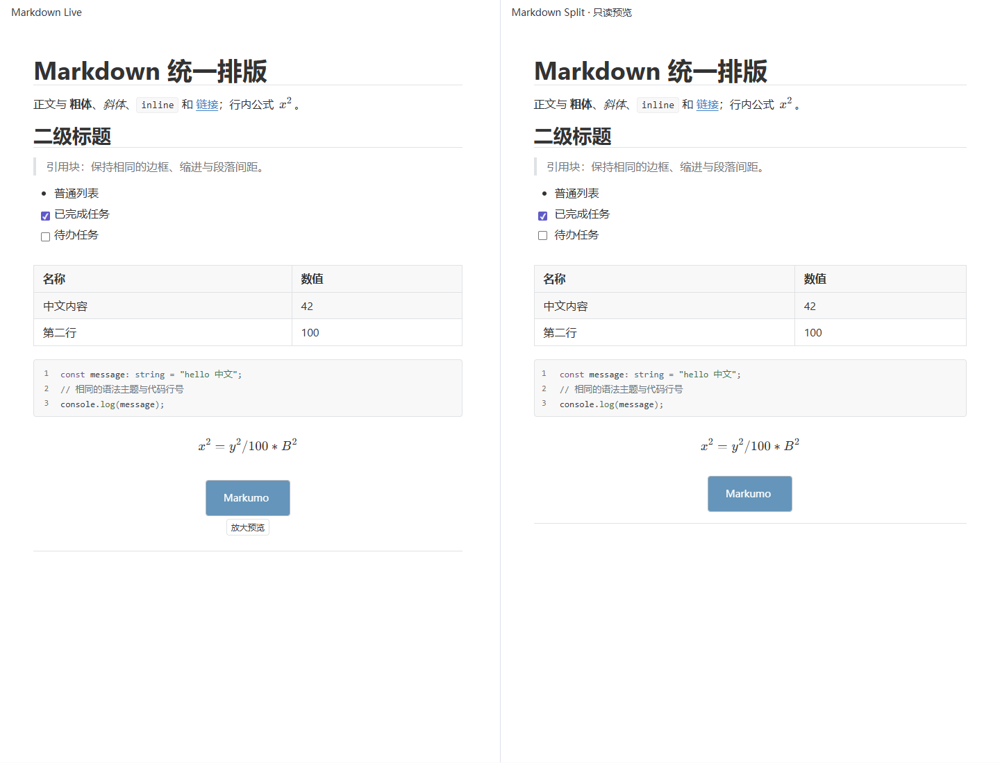
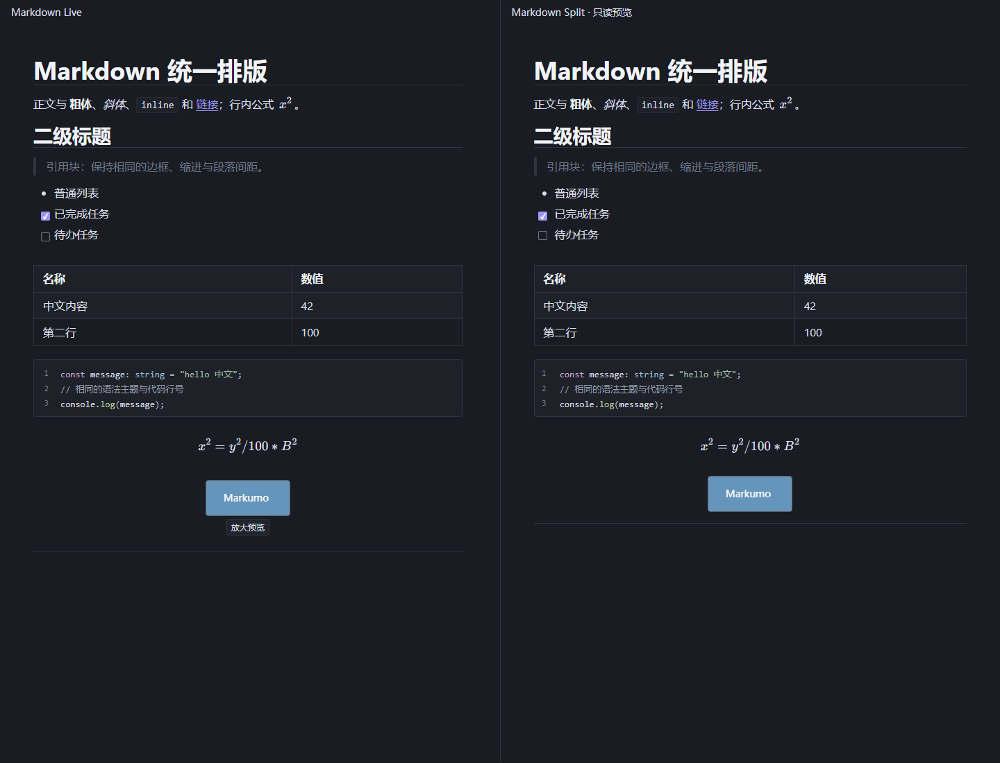
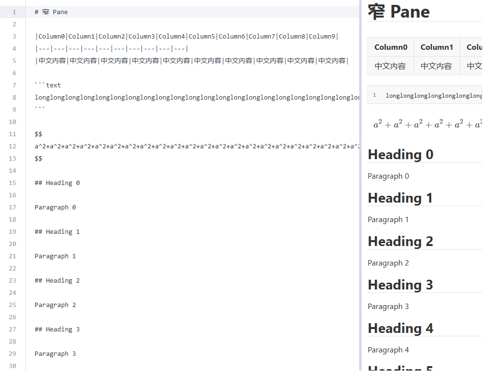
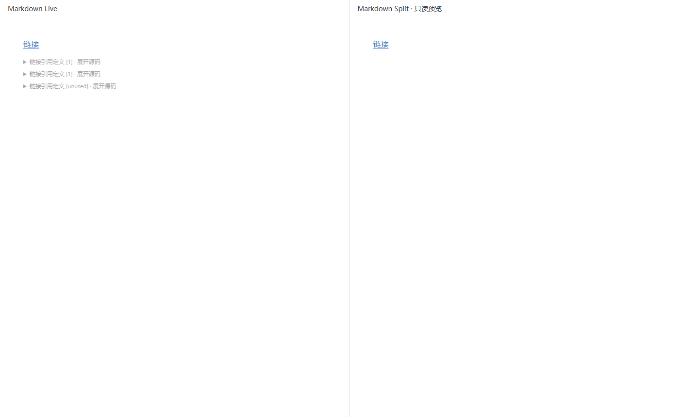
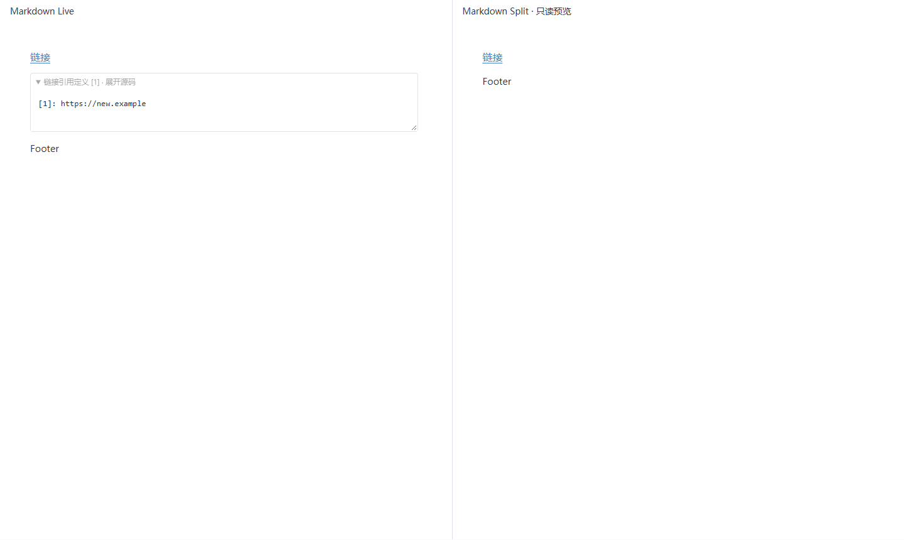

# Markdown Live / Split 统一化验收

实施：2026-10-21；最终验收：2026-10-22。基线：`dbc40f99be1482ef60fca1e223994ee0059a4d55`。全部修改在 `main`，未推送，未修改版本号；实施开始时用户原有的 `测试.md` 修改未纳入本轮提交。

## 根因

1. **公式**：Split 的 Markdown-it 没有注册 Live 的数学语义，也没有调用异步 `renderMath()`。直接增加源码 data 属性仍会被 HTML 净化白名单移除，无法可靠挂载公式。
2. **代码块**：Split 使用独立的静态 HTML 和样式，没有 Live 的行号、Typography 设置及代码表面变量。按 HTML 字符串切行还会破坏跨行高亮标签，不能用于补行号。
3. **引用定义**：Markdown-it 15 的原生 `reference_definition` token 在 `strip_references` 核心规则中被删除；SourceBridge 将未被普通节点覆盖的源文本作为泛化 `protected_source` 兜底，UI 无法区分引用定义和未知扩展。兜底编辑器又默认占据较大面积。定义编辑后，前文未变化的源块也需要根据新的引用环境重建语义。

## 架构和行为

- `mathSemantics.ts` 提供 Live / Split 共用的美元符号识别和块公式拆解；`MathSource.ts` 复用拆解。围栏代码、转义和金额不作为公式，LF / CRLF 与多行公式有回归覆盖。
- Split 每次解析使用独立的环境对象保存公式、代码、图表、图片和任务状态。净化后的 DOM 只携带随机标识 `data-md-render`，源码保留在内存映射中。未知或伪造标识不能挂载资源。沿用 HTML 净化、本地图片授权、网络图片显式许可和安全链接入口。
- `renderMath()` / `renderDiagram()` 仍按需加载。挂载前后检查预览代次、源文本快照、连接状态和销毁状态，主题变化另有图表版本校验。过期结果丢弃；Split 公式没有 Live 编辑入口。静态导出的 renderer 不启用需要客户端挂载的数学占位机制。
- `staticCode.ts` 将现有语法解析器输出的源文本范围映射到逐行 DOM，跨行或重叠 token 不会产生损坏的标签。Split 不创建代码块 EditorView；复制从内存读取原始代码，不混入行号。软折行保留一个逻辑行号。Mermaid 走既有严格图表 renderer。
- 原生引用 token 在删除前捕获，并按原始范围保留定义、前缀和文档尾部。重复标签、未使用定义、多行定义、LF / CRLF 均无损往返。标准定义默认只有紧凑入口，首次展开才创建 textarea；YAML、脚注、TOC、Callout、HTML 和未知扩展保留各自分类和源码入口。
- 定义修改通过 SourceBridge 原有源事务提交；当前编辑节点在临时清空内容时继续存在，保持焦点。其他源块根据新引用环境重新解析，同一文档其他 Pane 同步。源事务只写实际修改的定义，保持引用写法和一次正常撤销，不把语义刷新额外记录进 Undo。
- `typography.ts` / `presentation.css` 统一正文、H1–H6、段落、列表、引用、任务、表格、公式、图片、链接、分隔线及代码表面。正文 `fontSize` / `fontFamily` / `lineHeight` / 阅读宽度适用于两种模式；代码沿用 Live 的等宽 13px / 1.65 基准，两边共同响应 `codeLineNumbers` / `codeWrap`，不会被正文字体设置意外改变。
- 使用 Pane 容器查询：560px 以下缩减左右内边距至 20px，360px 以下为 12px。表格、代码、宽公式单独滚动。Live 使用现有依赖的 `TableView` 提供表格滚动容器，并适配表格工具栏定位和选表行为。Split 拖拽及方向键调整比例不重建编辑器、不修改正文、不增加 Undo 历史。
- 预览仍按 60ms 合并源更新，再生成受保护的静态 HTML；不是块级 DOM diff 引擎。更改 Typography 和拖拽比例不重建代码实例。

## 安全与预算

| 对象 | 限制与回退 |
| --- | --- |
| 文档 | 超过 1 MiB 字符长度暂停预览，源码继续可编辑 |
| 公式 | 每次预览最多 256 个；每个最多 4096 字符；KaTeX `trust:false`、`strict:'error'`、`maxExpand:200`、`maxSize:20` |
| 图表 | 每次最多 16 个；既有 8000 字符 / 200 行预算，strict 安全等级，HTML 标签关闭 |
| 代码 | 高亮最多 64 KiB；显示最多 128 KiB / 5000 行，达到预算显示提示，复制仍使用完整原始代码 |
| 图片 | 沿用最多 64 个 Markdown 图片及既有资源权限和生命周期管理 |

长度预算按 JavaScript 字符串长度计算，并非磁盘编码字节数。渲染失败呈现可读错误，用户源文本不变。没有增加运行时依赖。

## 真实浏览器截图

Windows / Google Chrome 155.0.8059.85，Playwright 无头浏览器。左侧为 DocumentManager 创建的真实 Live 编辑器，右侧为同文档 Split 只读组件；窄屏图使用实际 EditorPane 的源码 / 预览双栏。以下原始截图已逐张打开检查，未作图像后处理。

### 浅色对照

### 深色对照

### 实际窄 Pane

### 引用定义

Live 图片保留编辑操作入口，Split 保留只读权限操作，因此交互控件及其空间允许存在差异。

## 实际修改文件

| 文件 | 职责 |
| --- | --- |
| `src/editor/markdown/mathSemantics.ts`、`wysiwyg/MathSource.ts` | 共享数学识别与源码拆解 |
| `src/editor/markdown/rendering.ts`、`splitPreview.vue` | 安全静态渲染、只读挂载、预算和更新防护 |
| `src/editor/markdown/html/SafeHtmlRenderer.ts` | 允许受控标识通过净化 |
| `src/editor/markdown/staticCode.ts` | 逐源行高亮和行号 |
| `src/editor/markdown/typography.ts`、`presentation.css`、`wysiwyg/MarkdownTheme.css` | 共享设置和视觉样式、紧凑源码入口 |
| `src/editor/markdown/wysiwyg/MarkdownParser.ts`、`MarkdownSchema.ts` | 原生引用范围和受保护源码分类 |
| `src/editor/markdown/wysiwyg/MarkdownSourceBridge.ts`、`MarkdownEditorController.ts` | 引用事务与跨 Pane 语义同步、Live 设置、表格容器 |
| `src/editor/markdown/wysiwyg/LiveTableToolbar.ts` | 滚动容器下工具栏定位 |
| `src/editor/markdown/wysiwyg/renderers.ts` | 图表异步结果保护 |
| `src/components/layout/EditorPane.vue` | 设置传递、比例与拖动清理、键盘调整 |
| `scripts/split-preview-regression.mjs`、`run-regressions.mjs`、`regression-server.mjs` | 新专项浏览器测试，注册 Smoke / 全量回归，隔离测试服务器端口和缓存 |
| 本文和 `docs/images/markdown-split/*.png` | 验收报告和真实截图 |

## 自动化验收

新增专项 12 组，覆盖公式、换行/特殊字符、金额/代码排除、异步更新、预算、静态代码高亮/行号/复制/软换行、引用范围/编辑/无损序列化、各类受保护语法、两种主题与共同排版指标、实际 Pane 拖拽/滚动同步、多 Pane、Source/Live/Split 往返、Undo/Redo、保存/重新打开及 HTML/图片/Mermaid 安全。

保存重开专项使用真实 FileController 和 DocumentManager，文件网关使用测试替身；未声称该浏览器场景执行了原生磁盘写入。

验收中发现并修复了两处兼容问题：Live 表格滚动容器下的工具栏仍假定相邻节点为 table；静态代码渲染漏掉既有 `language-*` 类。保留所有原有断言并修复实现，表格布局和 19 组语法回归随后全部通过。

截图测试增加展开状态验证后，发现原生 details 的 toggle 事件与按需 textarea 创建之间存在异步间隔；改为等待可见性后继续断言。另修正 Vite 6 将 `port:0` 当作默认端口的问题，使用操作系统分配的正端口隔离两个专项服务器。

完整回归过程中，更新器专项曾在 `window.f` 初始化等待处出现一次 10 秒超时；未修改更新器实现或删减断言，单独复验 32 组通过。最终套件结果另列，保留这条环境波动记录。

最终命令执行结果见本节完成记录。验收基于当前 main 工作区；其他并行任务已有的未提交修改保持原样，未纳入本轮提交。

| 最终执行项 | 结果 |
| --- | --- |
| `pnpm typecheck` | 通过，退出码 0 |
| `pnpm build` | 通过，退出码 0；Vite 保留大 chunk 提示，无构建错误 |
| `pnpm test:smoke` | 28 / 28 通过，0 失败，0 跳过，247.90 秒 |
| `pnpm test:regression` | 39 / 39 通过，0 失败，0 跳过，317.77 秒 |
| Split 专项 | 12 组通过，浏览器无 pageerror |
| 大纲跳转与滚动联动专项 | 13 组通过，保留原有跳转、宽度、多 Pane 检查 |

日志保存在 `test-results/split-unification/`；详细子套件日志由仓库运行器保存在 `test-results/regression-logs/`。

## 阶段提交

| 阶段 | Commit SHA | 标题 |
| --- | --- | --- |
| 01 | `2ff8a125345b3e58945874a18707f71a0ee85916` | `fix(markdown): render math consistently in split preview` |
| 02 | `b1f3d660443274746c413377b22e627fc5f8eb53` | `feat(markdown): unify split code block presentation` |
| 03 | `82d2d9d69b08ecb64eafada4af7a382abfa96d78` | `fix(markdown): improve reference definition presentation` |
| 04 | `a96f719c4c2e7bb33ab4dea1caa5ac8ec39e491f` | `refactor(markdown): share live and split reading presentation` |
| 05 资料 | `9e7a01ee3a10f6f7973d239ee5cbf0c4293feba9` | `docs: 添加 Markdown Live/Split 统一化验收文档及截图` |
| 05 最终验收 | 本验收提交（最终回复列出 SHA） | `test(markdown): 完成 Split 与大纲联动验收` |

追加的「滚动正文时，大纲当前标题加粗」功能独立提交于 `729e7294f1141a0cb939a59645025136c9b5166a`，实现、边界及截图见 [大纲滚动联动验收](outline-scroll-follow.md)。

## 已知边界和人工确认

- 真实浏览器测试不能替代 Windows Tauri WebView 的 DPI、字体回退和输入法交互人工检查；建议在实际桌面端以常用缩放比例复核。
- 极大代码、公式、图表按上述预算回退；静态代码折行不会伪造额外行号。复杂或未知 Markdown 扩展继续保留源码，未引入新的扩展执行器。
- 引用定义紧凑节点针对原生顶层定义；嵌套在容器中的复杂定义继续遵循现有容器解析和源码保留方式。
- 文档更新会刷新静态预览 HTML，未实现逐块增量 DOM 复用；Source / Live 编辑器生命周期和 Undo 与只读预览隔离。
