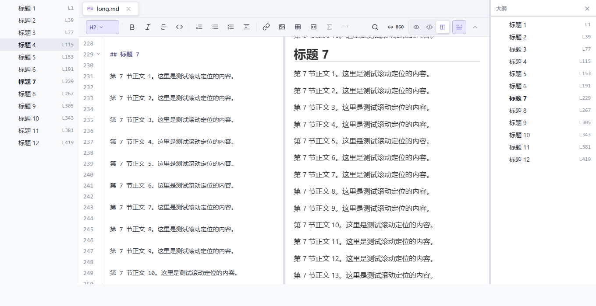

# 大纲随正文滚动加粗

2026-10-22：Markdown 正文滚动时，左右两个大纲入口加粗当前活动 Pane 所在的章节标题；点击大纲仍沿用已有跳转行为。

- Live 从 ProseMirror 视口读取源位置，源码模式从 CodeMirror 可见行读取位置，Split 从预览标题的实际边界读取位置。阅读锚点距视口顶部 24px，与现有大纲跳转留白一致。
- 当前项使用 `aria-current="location"` 和 700 字重。子标题被折叠时，标记可见的父标题，不改变用户的折叠选择。
- 使用每帧合并的只读测量；同一文档多 Pane 只跟随当前活动 Pane。忽略嵌套代码编辑器的局部滚动。切换文档/模式、Pane 尺寸变化、图片加载会重新测量，组件卸载时移除订阅、观察器和监听器。
- 不改变正文、光标、选区、脏状态或 Undo 历史；未增加依赖。

专项：`scripts/outline-navigation-regression.mjs` 原有 9 组跳转/宽度/多 Pane 测试保留，新增 4 组 Live、源码、Split 和折叠父项滚动联动测试，共 13 组通过。测试服务器使用动态端口，避免与其他本地测试冲突。
