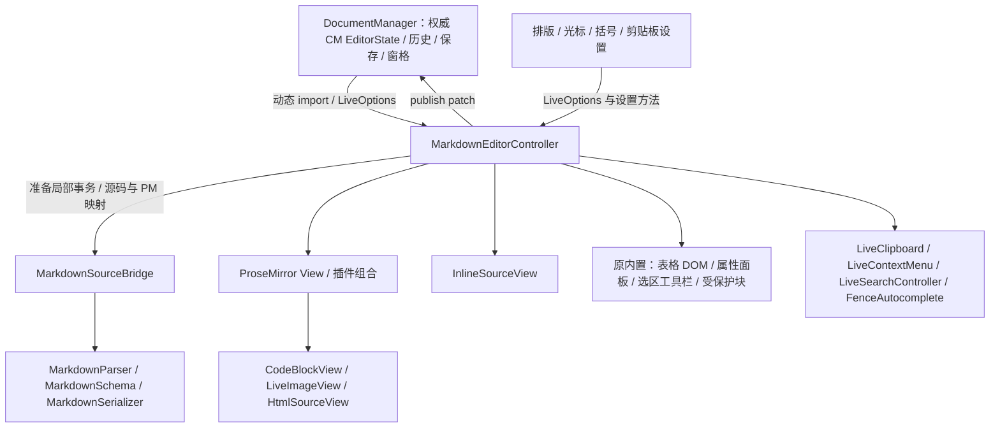

# Phase 05：Markdown Live 控制器渐进解耦审查记录

验收基准：`2069251c3b44c2f344e1a2722ed6e80bbade36f7`。本次只提取表格工具栏 DOM，不修改版本、发布或推送。工作区开始时已有的 languages/index.ts、ExportAppearance.ts、ExportStyles.ts 变动未纳入本次修改。

## 1. 原控制器职责图与已有边界

这是职责和调用关系图；CM EditorState 仍是唯一权威 Markdown 状态，PM 文档是编辑投影。节点视图中的 CM 是局部编辑器，不建立独立文档历史。

| 已有模块 | 职责及边界 |
| --- | --- |
| DocumentManager | 文档记录、权威 CM 状态、共享历史、dirty/save snapshot、窗格、Live 懒加载与 publish 接入。 |
| contracts.ts | LiveEditor、LiveOptions、排版及剪贴板类型；本次全部保持兼容。 |
| MarkdownSourceBridge | 原始区块、前后缀、解析环境、prepare/publish/patch、源码与 PM 位置映射。 |
| MarkdownParser / Schema / Serializer | 语法、节点类型、区块序列化；已有增量和原始源码保真能力继续复用。 |
| InlineSourceView | 行内源码编辑、范围定位、组合输入和待提交内容。 |
| CodeBlockView / LanguageSelector | 嵌入 CM、代码事务桥接、异步语言加载；语言选择浮层已有独立所有者。 |
| LiveImageView / ImagePreview | 图片加载与资源预算、预览、源码与属性请求回调。 |
| HtmlSourceView / HtmlBlockView / HtmlInlineView | 共享 HTML 源码编辑与安全预览；两个包装节点视图继续复用它。 |
| LiveClipboard | 读取剪贴板、转换与异步变更检查；通过既有回调提交编辑。 |
| LiveContextMenu | 菜单 DOM、事件、关闭与销毁；菜单内容由控制器构建。 |
| LiveSearchController / plugins/LiveSearch | 搜索 UI、匹配状态、代码块内定位。 |
| FenceAutocomplete | 围栏语言补全 DOM 与交互。 |
| plugins/NodeTarget / SmoothCaret | 事务映射后的节点目标、派生光标展示。 |

审计结论：这些职责已独立，不能重复拆分。控制器仍是插件及 NodeView 组合根，还持有可变 View、bridge、行内编辑和属性目标。表格 DOM 只需三个动作回调，最适合本轮低风险提取。通用 `positionAnchoredElement` 服务于链接/图片/数学属性浮层，与表格的相邻 TABLE 定位不同，因此留在控制器。

现有子模块没有统一接收整个控制器，但并非都只有只读数据：CodeBlockView 接收 PM View、getPos、历史与搜索回调；LiveClipboard 接收可变 bridge 的 getter；LiveSearchController 能取得可变 Set<CodeBlockView>。这些依赖与事务及嵌套编辑器协调有关，不能在本轮随 UI DOM 一起抽走。后续可考虑收窄查询接口，但本次不引入适配层或第二套状态。

## 2. 本次提取与依赖

新增 `src/editor/markdown/wysiwyg/LiveTableToolbar.ts`，只负责按钮、菜单、位置对应的 DOM、显示/对齐状态、外部点击、Escape、事件注销及销毁。

控制器构造它时仅传 host 和三个类型明确的回调：

| 回调 | 控制器继续负责的工作 |
| --- | --- |
| selectTable(position, toolbar) | 从 PM 文档/DOM 找到表格；必要时移动真实选区和焦点。 |
| run(command) | 将七种行列/删除命令名映射为既有 PM Command，沿原 `run(command, true)` 隔离历史。 |
| align(value) | 沿原 `align` 和 `run` 执行对齐事务。 |

模块不导入 PM、bridge 或 DocumentManager，不接收整个控制器，不存储 EditorState、Markdown 或另一份历史；控制器的 decoration 继续负责按真实 PM 位置调用 `forTable/retain`。没有循环依赖、全局单例或新的同步解析。

DOM 类名、按钮名称、图标、几何计算及样式保持原样。菜单关闭从每次创建工具栏时新增一个匿名 host 监听器，改成每个实例一个可注销的监听器；位置变化后移除过期次级工具栏及其属性处理器。`destroy()` 有幂等保护，保留的旧按钮和晚到 `forTable` 不会恢复交互。

## 3. 规模和核心事务保护

| LF 归一化指标 | 原控制器 | 新控制器 | 新工具栏 |
| --- | ---: | ---: | ---: |
| 行数（不计末尾空行） | 1884 | 1750 | 162 |
| UTF-8 字节 | 86599 | 81749 | 7212 |
| AST decisionPoints | 522 | 504 | 24 |

两份生产文件合计 1912 行；总行数略增，收益在于 DOM 所有权和窄依赖，而非压缩代码。decisionPoints 统计条件、循环、catch、case 和逻辑运算，不等同于完整圈复杂度。测试 JSON 保存逐方法源码哈希。

原控制器中只有 constructor、updateTools、destroy 修改；tableToolbarFor/createTableToolbar 被提取，选区部分变为 focusToolbarTable。包括 dispatch、sync、run、align、format、clipboard、scheduleInlineEntry、closeInline、所有属性/节点视图编辑方法在内的既有方法源码哈希保持一致。MarkdownSourceBridge、Parser、Serializer、Schema、contracts、NodeViews、PM/CM 桥接、保存和 dirty 逻辑均未修改。DocumentManager 的两个最小例外均经过用户单独明确授权：activeViewFor 路由及 Live publish 的事件分类，见第 5 节。公开 API、publish 签名、版本/只读检查、patch 和事务分发协议、共享历史存储及 full 隔离注解不变。

`test-results/phase-05/core-preservation.json` 记录 48 个未变控制器方法、14 个完整未变文件，以及 DocumentManager 仅 activeViewFor 和 showActive 内上述元数据变化、其余 95 个成员实现未变的核对结果。将这两个方法换回原实现后，整个 DocumentManager 与基准逐字一致（LF 归一化）。两个授权阶段之前的记录另存为 core-preservation-before-routing.json 和 core-preservation-before-history.json。

## 4. 新回归实际执行路径

`scripts/fixtures/markdown-live-controller.js` 挂载真实 DocumentManager，通过原动态 import 创建控制器，编辑进入真实 PM dispatch、SourceBridge 和权威 CM 历史。只为隔离外部副作用注入内存 PNG 和文本剪贴板；没有用户文件、系统剪贴板、更新安装或重启操作。dispatch 包装器只观察 Live 发布次数并转发原实现。

`markdown-live-controller-regression.mjs` 的核心场景进入 Smoke；Full wrapper 额外执行 NodeView 与延迟懒加载场景。各用例失败后继续执行后续用例，最终仍以非零状态退出，不将失败改成跳过。

| 范围 | 实际断言 |
| --- | --- |
| 源码保真 | 多级标题、引用、列表/任务、表格、围栏语言参数、相对图片、代码/链接/引用链接、HTML、YAML、数学、空行及结尾换行；三轮模式切换不改写；局部修改只发布一个范围内 patch，无关后缀与保存快照保持一致。 |
| 撤销/重做 | 连续原生键事件、删除/合并段落、粗体/斜体/链接/插表、表格行列及对齐/删除、代码和 HTML 嵌入 CM、图片粘贴/属性；每个隔离逻辑动作检查权威历史深度与源码往返。 |
| 多窗格 | Live/Live、Source/Live、Live/Source：单次发布、真实焦点、远端映射选区、共享撤销、源码视图内容、反向编辑、标签恢复和关闭单窗格。获准修复后，混合模式也完整执行：源码光标映射、不抢 Live 焦点、随后从源码真实键入、两端更新与共享撤销/重做，源码输入不造成第二次 Live 发布。 |
| 表格 UI | 可见按钮、菜单关闭、Escape、外部点击、不移动表格布局、不丢失单元格选区、多表位置映射及操作目标。 |
| NodeViews | 可见语言按钮悬浮且不挤压代码块，选择语言后继续编辑；图片点击映射源码、真实右键属性；行内源码；HTML 源码编辑；YAML 展开/折叠。没有 force 点击。 |
| 生命周期 | IME 时阻止切模式；待执行行内编辑时销毁；8 次挂载/销毁；网络门控真实 Live 动态 import，关闭后释放加载仍不能复活；实际 PM/嵌入 CM 销毁、根节点/工具栏/浮层移除。 |
| 提取后的所有权 | 30 次表格位置变化仍只有一个根监听器；重复 destroy、旧按钮 click、晚到 forTable 均无效，监听器归零。 |

链接属性测试在可见链接上派发带坐标的真实 MouseEvent 类型 `contextmenu`，再点击真实菜单并编辑属性；这验证产品菜单和属性链路，不代表原生完整右键手势已修复。原生右键与行内编辑手势竞争是已有独立 UI 问题，保留为技术债。

## 5. 基线发现与获准修复

原始控制器与提取后控制器均出现 Source/Live、Live/Source 两项失败：Live 获得焦点后输入，权威文档变化，但源码 CM View 保持旧文本。

复现：同一 Markdown 分成两个窗格，一个 Source、一个 Live；聚焦 Live，编辑第一段；立即比较源码窗格 `view.state.doc` 与 `DocumentManager.getText`。两者不同。继续从旧源码视图提交编辑可能触发 change set 长度不匹配。

根因在 `DocumentManager.activeViewFor`：焦点窗格包含目标文档、却没有 CM View 时直接返回 null；后备遍历遇到同样的 Live 窗格也可能直接返回 null。dispatch 于是进入仅更新 record 的分支，绕过源码视图分发。现有 smooth-caret 测试覆盖了 Source 到 Live，未覆盖这个方向。

用户后续明确答复“允许最小修复并增加双向同步回归”。据此只修改 activeViewFor：优先使用活跃窗格中实际存在的 CM View；否则跳过没有 CM View 的匹配窗格，继续寻找同一文档的源码 View。焦点优先级和文档 ID 检查保留；没有源码 View 时仍返回 null，沿原权威状态分支处理。未改 dispatch、applyTransactions、accept、showActive/publish 或桥接协议。

新增的双向断言现已通过两种窗格排列：Live 编辑后源码内容立即一致、源码光标按 patch 映射、Live 保持焦点；随后真实浏览器输入进入源码 CM，再同步 Live，且没有长度不匹配、重复发布或第二份历史。共享撤销/重做、标签切换和关闭单窗格的后续断言也全部执行并通过。

原生连续输入也在原控制器与提取后控制器上同样失败：定位普通段落末尾，用独立键事件连续输入 `abc`，权威历史深度是 3，预期为一个连续输入组。不是用一次 insertText('abc') 代替连续键入。DocumentManager 的 Live publish 标记为 `input.markdown`，而当前 CM history 的可合并事件匹配 `input.type` 或 `delete`，这解释了分组丢失。

用户随后单独答复“允许最小历史修复并验证隔离边界”。因此只在原 publish 回调中分类事件：原 isolated 操作继续使用 input.markdown 和原 full 隔离注解；非隔离插入/替换使用 input.type.markdown，纯删除使用 delete.markdown。合并规则仍完全由现有 CM history 的邻接、时间与选区规则决定，不新增历史插件或单独栈，也不修改任何 NodeView/Bridge 协议。

新增真实输入边界测试已通过：连续 abc 单步撤销/重做；连续三次 Backspace 单步撤销/重做；输入、格式命令、再次输入分别为三个组；输入、粘贴、再次输入也分别为三个组。三个组逐步撤销并重做，精确恢复每个源码快照。两种混合窗格另验证：Live 原生连续输入后，从 Source 键盘撤销、再从 Live 键盘重做，只使用一个历史事件、没有重复发布。删除/合并段落、表格命令、代码/HTML 编辑及图片属性的既有隔离断言全部保留。

提取阶段用同一脚本复测原控制器：16 项中 13 通过、3 失败；新控制器：17 项中 14 通过、同样 3 失败（另加一项提取后所有权测试）。原控制器均核验与 HEAD 的归一化源码一致，并在 finally 中恢复本轮控制器。仅路由修复阶段为 17 项中 16 通过；两个获准修复及五项新增边界用例完成后，最终 Live 专项 **22/22 通过**，pageerror 和 editor-notice 均为 0。最终记录为 final-full.json，早期 before/after、mixed-pane-fix 记录保留供对照。

## 6. 性能与资源测量

同机 Windows x64，Node 22.2.0、Chrome 155.0.8059.80；不并发跑浏览器基准。固定 fixture 每类预热一次，再重复七次；每次 12 次真实 PM 编辑。普通 596 B、代码密集 30 个围栏、长文 86298 B、双 Live 95 B、模式切换 118 B、工具栏 95 B。既有安全预算没有调整。

`--profile --label=before/after` 的 JSON 保存提取阶段结果。最终在全部套件结束后、无并发浏览器测试时成对复测：临时恢复原控制器和原 DocumentManager，测量 final-baseline；finally 逐字节恢复最终源码后测量 final。初始化含重挂载及浏览器命令往返；edit 仅计 PM dispatch 到权威 Markdown 和其他 Live 同步的同步耗时，不是键入到画面呈现的延迟。毫秒以下差值及一次七样本对比只能作描述，不能据此断言显著性能提升或回退。

| 场景 | 初始化中位 ms 前→后 | edit 中位/P95 ms 前→后 | DOM 前=后 | PM/嵌入 CM |
| --- | --- | --- | ---: | --- |
| 普通 | 8.61→8.06 | 0.40/0.70→0.40/0.70 | 133 | 1/0 |
| 代码密集 | 29.38→31.58 | 0.30/0.60→0.30/0.60 | 971 | 1/30 |
| 长文 | 21.84→24.09 | 1.60/2.30→1.60/2.40 | 971 | 1/0 |
| 双 Live | 8.48→8.43 | 0.40/0.70→0.50/0.70 | 226 | 2/0 |
| 切换模式 | 7.17→6.84 | 0.30/0.50→0.30/0.40 | 143 | 1/1 |
| 工具栏循环 | 5.38→6.45 | 0.30/0.50→0.30/0.50 | 113 | 1/0 |

表格取最终成对复测 final-baseline-performance.json / final-performance.json；提取阶段和路由阶段的全部旧结果继续保留。8 轮模式切换合计中位 56.8→57.6 ms；80 轮菜单打开/关闭 1.2→1.4 ms。同步编辑中位增加最多 0.10 ms，DOM 和编辑器实例数量一致。代码密集初始化增加 2.20 ms、长文增加 2.25 ms；早期代码密集测量曾增加 1.06–5.08 ms，单轮小样本不能据此确认归因或显著性。没有更改安全预算，也没有用较快的一轮覆盖旧结果。

普通和工具栏场景，12 次表格前插入使原根 mousedown 从 1 累积至 13，新实现保持 1；子树显式监听器 46→34。双 Live 原根监听器合计 26，新实现 2；子树监听器 92→68。代码、长文、模式切换的计数一致。计数通过 WeakMap 跟踪真实 add/remove，避免测量本身保留已移除 DOM，不计属性事件与浏览器内部监听器。

所有六类、全部重复均断言实际 PM/CM View 已销毁，视图/工具栏 DOM 剩余 0。全页面仍有 14 个模块共享显式监听器，前后相同；未将它们虚报为全部注销，也未用 DOM 数量代替堆内存测量。

## 7. 验证与 CI

类型检查、生产构建、Rust check 已通过；Rust test 26/26 通过。已有专项：rich-clipboard 27、brackets 21、smooth-caret 23、DocumentManager 15、table-layout 4、heading-outline 3、outline-navigation 9 均通过。

提取阶段完整 Smoke / Regression 已执行：Smoke 11 个脚本中 10 通过、1 失败、0 跳过；Full 22 个脚本中 21 通过、1 失败、0 跳过。该阶段唯一失败脚本为本次新门禁，含上述三个基线失败。其余全部原有脚本通过，包括媒体、HTML/导出代码、工作区、生命周期、原生拖放及产物/发布静态验证。没有跳过媒体 fixture；使用现成隔离 fixture，未触及用户文件。

提取阶段复跑：Smoke 91.56 s，Full 154.23 s。Full 新门禁另检查了产品 editor-notice，不允许吞掉编辑或晚到回调错误后只凭 pageerror 为 0 宣称通过。获准路由修复阶段 Smoke 仍因历史分组失败；Full 20/22 个脚本通过，另暴露媒体等待竞态（完整旧日志保留 mixed-pane-fix-*）。

媒体第 15 场景原先仅等“两窗格合计至少两个 PDF 文本 span”；这些 span 可以全部来自左 PDF，而右 PDF 仍在加载，所以右侧导航可见断言偶发失败。只给两个导航各补充真实 visible 状态等待，原可见性和独立状态断言全部保留，PDF 产品代码不变。单独重跑媒体用例通过。

最终类型检查、构建已通过，Smoke **11/11 个脚本通过，0 失败、0 跳过**（97.03 s）；Full **22/22 个脚本通过，0 失败、0 跳过**（152.31 s）。最终 Live 专项 **22/22**，核心集 **18/18**，均无 pageerror 或 editor-notice。两个后补的混合窗格原生历史用例已包含在这两次专项结果中；总门禁通过后完成的成对测量及核心集复测，均确认源码已经恢复为最终版本。日志命名 final-*，保留早期失败证据。

详细证据位于 `test-results/phase-05/`：最终 final-full.json、final-smoke.json、final-smoke.log、final-regression.log、final-typecheck.log、final-build.log、final-media.log、final-baseline-performance.json、final-performance.json 和 core-preservation.json；初始 before/after、mixed-pane-fix、Rust 日志一并保留。用例级完整日志也在 `test-results/regression-logs/`。

基准 commit 的 [Quality Gate run 39225863135](https://github.com/pucj0/Markumo/actions/runs/39225863135) 已核验：Frontend Quality 与 Rust Quality 均 success。本轮修改尚未推送，远程没有本轮变更的运行结果，不能将基准绿灯当作本轮通过。

## 8. 剩余技术债与审查结论

- 混合 Source/Live 反向同步及连续键入历史分组均已分别获得明确授权并最小修复，新增边界、双向测试及本地完整门禁通过。未发现必须继续修改核心才能完成本轮本地验收的阻塞；仍需人工代码审查与本轮提交后的远程 CI 验证。
- 控制器仍负责插件组合、复杂选区/属性目标、行内编辑、数学/受保护块协调；本阶段不继续提取。
- 链接原生右键可能先激活行内源码；本次仅验证菜单事件到属性提交链路，未扩大到独立交互修复。
- 性能记录不是堆快照，也不覆盖操作系统输入到绘制的端到端延迟；后续可增加长时间堆保留测量。

修改完成后保留工作区供人工审查；不提交、不推送、不发布。
