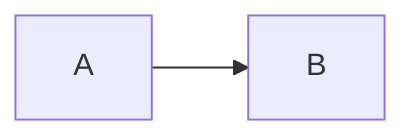

# 阶段 A — Markdown 核心

## H2 中文 English

### H3

#### H4

##### H5

###### H6

第一行 plain text
第二行 **加粗**、*斜体*、~~删除~~、``code ` inside``。
硬换行  
下一行。

> 一级引用
> > 二级引用 **nested**
> >
> 尾段

- 第一项
  - 二级项
    - 三级项
- [ ] 待办 中文
- [x] 已完成 task

1. 一
2. 二
   1. nested

```js
const message = "中文 English";
console.log(message);
```

```sql
SELECT name FROM documents WHERE id = 1;
```

```unknown-language
<script>this is literal text</script>
```


内联  图像。


[Markdown link](https://example.com "title")

| 左 | 右 |
| :--- | ---: |
| **加粗** | `code` |

---

以下是差距审查样例，未实现时必须保留源码：

$x^2$ 与 $$a+b$$

脚注[^note]

[^note]: 脚注内容

[toc]



> [!NOTE]
> Alert content

最后一段。
