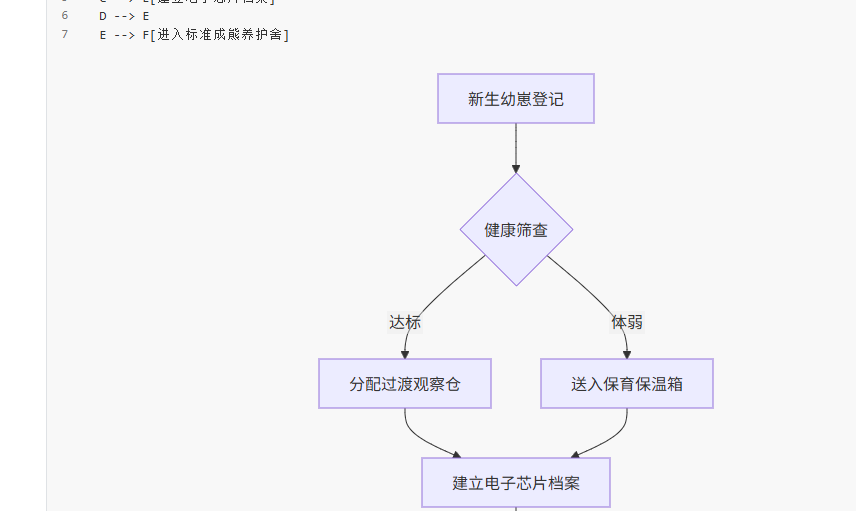
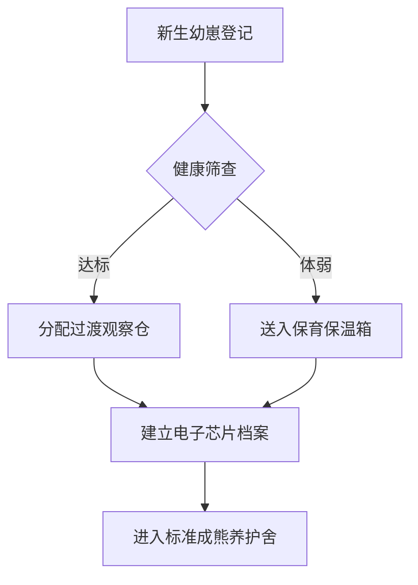

# 基于 SpringBoot+Vue 的金丝熊舍管理系统

这是一个面向宠物仓鼠及金丝熊繁育与健康档案管理的现代化 Web 系统。项目源码托管于 [GitHub 仓库](https://github.com/pucj0/lightEdit)，欢迎提交 Issue 与 Pull Request。

[toc]

## 一、系统简介

本系统采用前后端分离架构，前端基于 **Vue 3** 与 **TypeScript** 构建响应式管理面板，后端采用 **Spring Boot 3** 提供安全的 RESTful API，数据持久化依托于 **MySQL 8.0**。

> **核心设计理念**：让养殖记录更加规范化、生命周期可追踪化，同时提供直观的可视化数据报表。
>
> 具备*日常健康打卡*、*繁殖谱系追踪*、~~纸质手工台账~~ 全流程电子化管理功能。

### 1.1 系统预置登录账号

| 角色类型 | 登录账号 | 初始密码 | 权限范围 |
| :--- | :---: | :---: | ---: |
| 超级管理员 | `admin` | `Admin@2026` | 全平台系统配置与审计 |
| 饲养主管 | `keeper_lead` | `Keeper#123` | 仓位调配与谱系录入 |
| 兽医师 | `vet_doctor` | `VetPass!88` | 诊疗记录与处方归档 |
| 访客体验员 | `guest` | `123456` | 只读统计报表浏览 |

---

## 二、功能特性与开发任务

### 2.1 待办任务清单

- [x] 完成仓鼠品种档案库初始数据灌入
- [x] 实现基于 JWT 的双 Token 登录认证鉴权
- [ ] 接入温湿度传感器物联网数据上报网关
- [ ] 导出 PDF 格式的金丝熊健康体检报告

### 2.2 多级架构规范

1. 基础设施层 (Infrastructure)
   - 数据库连接池 HikariCP
   - Redis 缓存与限流
2. 业务核心层 (Core Domain)
   - 熊舍仓位排班算法
   - 血统近亲系数预警
     - 5代内血亲智能检测
     - 遗传病史标记
3. 前端展示层 (Presentation)
   - 仪表盘统计卡片
   - 繁育血统关系树

---

## 三、核心模块代码实现

### 3.1 前端状态管理 (JavaScript / Vue)

~~~~javascript
import { defineStore } from 'pinia';
import { ref, computed } from 'vue';

export const useHamsterStore = defineStore('hamster', () => {
  const hamsters = ref([]);
  const activeCageId = ref(null);

  const healthyCount = computed(() => {
    return hamsters.value.filter(h => h.status === 'HEALTHY').length;
  });

  async function fetchCageHamsters(cageId) {
    activeCageId.value = cageId;
    const response = await fetch(`/api/cages/${cageId}/hamsters`);
    hamsters.value = await response.json();
  }

  return { hamsters, activeCageId, healthyCount, fetchCageHamsters };
});
~~~~

### 3.2 后端控制器 (Java / SpringBoot)

```java
package com.hamster.system.controller;

import org.springframework.web.bind.annotation.*;
import org.springframework.http.ResponseEntity;
import java.util.List;

@RestController
@RequestMapping("/api/hamsters")
public class HamsterController {

    private final HamsterService hamsterService;

    public HamsterController(HamsterService hamsterService) {
        this.hamsterService = hamsterService;
    }

    @GetMapping("/cage/{cageId}")
    public ResponseEntity<List<HamsterDTO>> listByCage(@PathVariable Long cageId) {
        List<HamsterDTO> result = hamsterService.findByCageId(cageId);
        return ResponseEntity.ok(result);
    }
}
```

### 3.3 数据表结构定义 (SQL)

```sql
CREATE TABLE `hamster_profile` (
  `id` BIGINT NOT NULL AUTO_INCREMENT COMMENT '主键ID',
  `name` VARCHAR(64) NOT NULL COMMENT '金丝熊昵称',
  `gender` ENUM('MALE', 'FEMALE') NOT NULL DEFAULT 'FEMALE',
  `cage_no` VARCHAR(32) NOT NULL COMMENT '所在笼位编号',
  `weight_gram` DECIMAL(6,2) NOT NULL DEFAULT 120.00 COMMENT '体重(克)',
  `birth_date` DATE DEFAULT NULL COMMENT '出生日期',
  `created_at` DATETIME NOT NULL DEFAULT CURRENT_TIMESTAMP,
  PRIMARY KEY (`id`),
  KEY `idx_cage_no` (`cage_no`)
) ENGINE=InnoDB DEFAULT CHARSET=utf8mb4 COMMENT='金丝熊档案表';
```

---

## 四、繁育算法与关系图谱

### 4.1 近亲系数遗传数学模型

繁育近亲系数计算依据赖特定理 (Wright's coefficient of relationship)[^wright]：

$$
F_X = \sum \left( \frac{1}{2} \right)^{n_1 + n_2 + 1} (1 + F_A)
$$

其中 $n_1$ 与 $n_2$ 分别表示共同祖先 $A$ 到父本与母本的世代步长。

### 4.2 熊舍流转业务时序






---

## 五、笼位实景与展示


[^wright]: Wright S. Coefficients of inbreeding and relationship. The American Naturalist, 1922.
